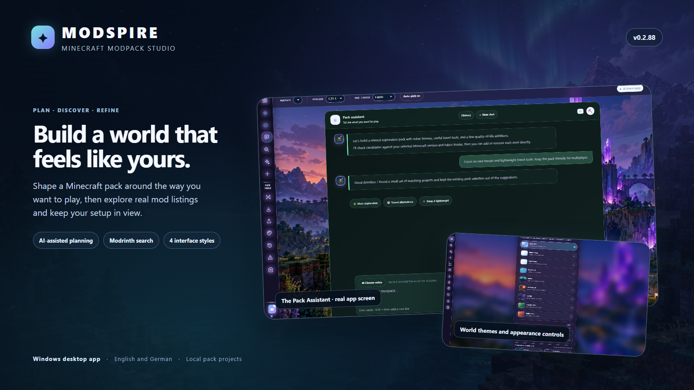
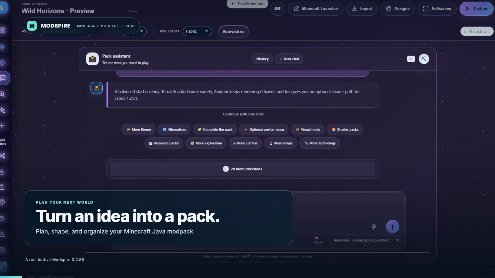
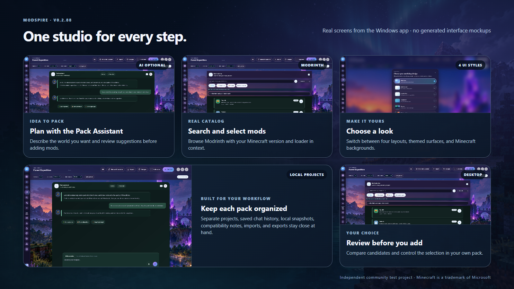
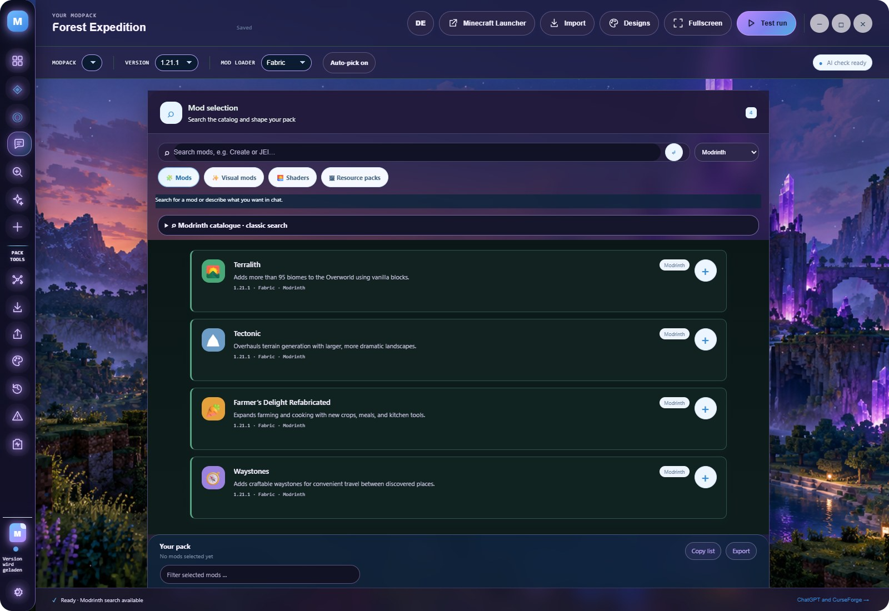
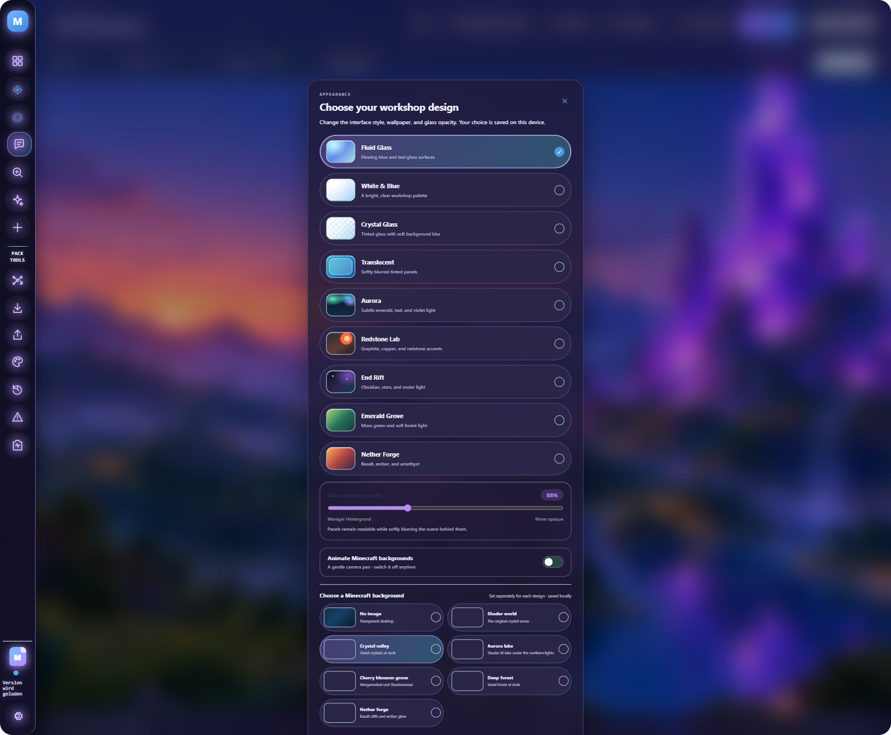
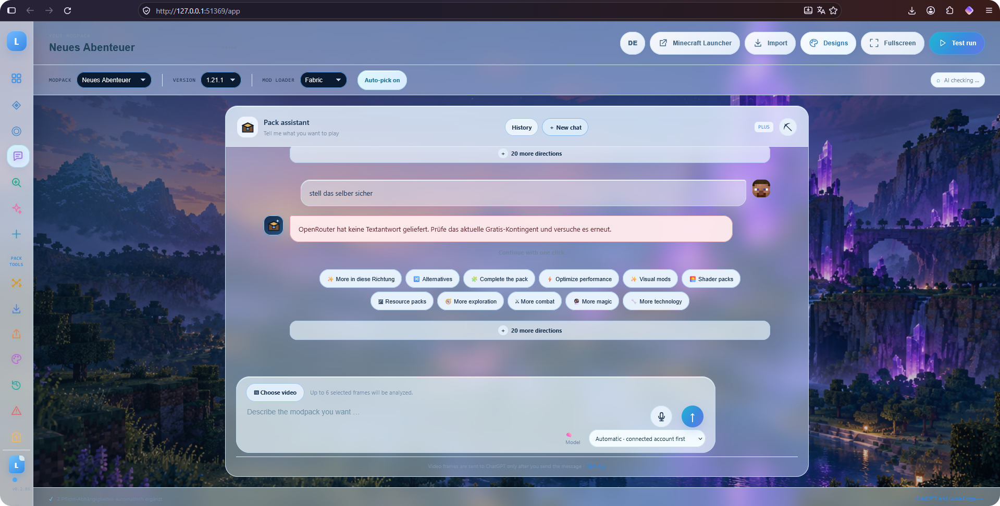

<div align="center">
  
  <p><strong>🌌 Your Minecraft Java modpack studio</strong><br>Search Modrinth, build a shortlist, and inspect your Minecraft Java pack. Local-first. AI optional.</p>
  <p>
    <a href="https://github.com/LvisXVI/modspire/releases/latest"></a>
    
    
    <a href="docs/wiki/README.md"></a>
  </p>
  <p>
    <a href="https://lvisxvi.github.io/modspire/">🌐 Open extended preview & interactive demo</a> ·
    <a href="https://github.com/LvisXVI/modspire/releases/latest">⬇️ Download for Windows</a> ·
    <a href="https://github.com/LvisXVI/modspire/wiki">📚 Read the wiki</a> ·
    <a href="https://github.com/LvisXVI/modspire/discussions">💬 Feedback & ideas</a>
  </p>
</div>

> **New in [0.2.98](https://github.com/LvisXVI/modspire/releases/tag/v0.2.98):** Undo selection changes, name pack variants, and share mod lists with project links. [Try the browser demo](https://lvisxvi.github.io/modspire/#demo) before downloading.

## 🎬 See Modspire in action

Click the preview to open the hosted video player. GitHub's file browser cannot preview large MP4 files.

<p align="center"><a href="https://lvisxvi.github.io/modspire/"></a></p>

The tour uses a real recording of Modspire. The feature gallery below also shows the actual app interface; those panels are screenshots rather than generated mockups.

<p align="center"></p>

## ✨ Explore the studio

<table>
  <tr>
    <td width="50%"><br><strong>🤖 Pack Assistant</strong><br>Shape an idea into a pack plan, then continue with relevant choices in chat.</td>
    <td width="50%"><br><strong>🔎 Modrinth catalog</strong><br>Search, filter, compare, and add candidates with your game setup in view.</td>
  </tr>
  <tr>
    <td width="50%"><br><strong>🎨 Appearance studio</strong><br>Choose among four layouts, visual themes, and Minecraft backgrounds.</td>
    <td width="50%"><br><strong>🌐 Local web view</strong><br>Open the same local workspace in your browser while the desktop app is running.</td>
  </tr>
</table>

## 🧰 What you can do

- 🗂️ Keep multiple pack projects with separate Minecraft versions, loaders, selections, and chat histories.
- 💬 Describe the experience you want and review AI-assisted Modrinth suggestions before changing your pack.
- 🔍 Search Modrinth directly without an AI account; filter by topic, version, loader, category, environment, and popularity.
- 🧩 Add candidates or a pack foundation in batches, inspect dependencies, and review compatibility notes.
- ↶ Undo or redo selection changes from the pack toolbar; Ctrl/Cmd+Z and Ctrl/Cmd+Shift+Z (or Ctrl+Y) work outside text fields. History lasts for the current session and resets when the pack or game setup changes.
- 🔗 Copy a shareable mod list with project links, Minecraft version, loader and dependency labels; give saved Pack Lab snapshots a name to distinguish variants.
- 📦 Import a Modrinth share code, public pack link, or `.mrpack` into an editable project, then export your selection.
- 🛠️ Develop a mod idea into a specification and starter-code outline with the AI Mod Creator.
- 🧪 Review a project in Pack Lab with mod roles, category balance, snapshots, and a Crash Analyzer that explains likely causes, cites nearby log evidence, and names a mod only when the log supports it.
- ⭐ Explore weekly Modrinth favorites beside all-time follows. Weekly growth is calculated from private local daily snapshots and falls back clearly to total follows until a full week is tracked.
- 🖼️ Switch layouts, themes, and Minecraft backgrounds; save the appearance on this device.
- 🖥️ Open the local web view from the desktop app and work with the same local projects.
- 🧠 Choose ChatGPT account access, optional OpenAI or Anthropic API providers, local Ollama/Bionic models, compatible OmniRoute endpoints, and a local OpenCode server.

> **Project limits:** Modspire helps organize packs and review metadata. It does not download every mod, install a Minecraft loader, or prove that a pack starts in a game world. See the [community test disclaimer](PUBLIC-TEST-DISCLAIMER.md).

## 🙌 Help shape Modspire

Try the [interactive demo](https://lvisxvi.github.io/modspire/#demo), or download the [portable Windows app](https://github.com/LvisXVI/modspire/releases/latest). Start with a Minecraft version and loader, search for a mod, then add and remove a few candidates. Catalog search needs no AI account.

Found something confusing? [Report a bug](https://github.com/LvisXVI/modspire/issues/new?template=bug_report.yml) or [share feedback](https://github.com/LvisXVI/modspire/discussions). Include your app version, UI/theme, what you expected, and what happened. Screenshots help; remove keys, names, paths, and other private details first.

Want to contribute code, translations, or documentation? See [CONTRIBUTING.md](CONTRIBUTING.md). If Modspire is useful to you, sharing the [live preview](https://lvisxvi.github.io/modspire/) with a friend helps others discover it.

## 🧠 AI and local models

Mod search works without AI. AI access is optional. Available routes depend on the account, provider, model, and local runtime configured on the computer. OmniRoute's `auto` selection uses providers already configured in that OmniRoute service; Modspire does not add credits or configure upstream providers. Local-model feature support varies, and this project has not been tested with every model or agent.

Credentials are stored by the desktop service and encrypted with Windows DPAPI-backed Electron `safeStorage` where available. Chat text and media are sent to the selected AI provider only when submitted. Review that provider's privacy and usage terms.

## 🚀 Get started

Download the latest Windows build from [GitHub Releases](https://github.com/LvisXVI/modspire/releases/latest), or run the source on Windows 10/11 with Node.js 22+ and pnpm:

```powershell
pnpm install
pnpm start
pnpm test
pnpm dist
```

The portable executable is written to `release/`. The first launch asks for a local display name. That name is not an account and does not remove limits imposed by AI providers. CurseForge search requires the user's own approved API key; without one, search falls back to Modrinth.

OpenCode is available as an explicitly selected chat route. Configure a provider in OpenCode, then connect it in Settings. Its restricted free tier is not generally available to external clients; see [OpenCode setup and limits](docs/wiki/ai-privacy.md#opencode-setup).

## 🌐 Local web view

The **Web Version** button opens the same workspace in the default browser at a local `127.0.0.1` address. Keep the desktop app open while using it. Project data and provider credentials stay in the desktop service; the browser does not receive saved API keys. The app pauses desktop editing during the browser session to avoid conflicting changes.

## 📚 Project docs

The [project wiki](docs/wiki/README.md) covers the [feature patch log](docs/wiki/patch-log.md), setup, providers, search, design modes, privacy, troubleshooting, and development. The [community test disclaimer](PUBLIC-TEST-DISCLAIMER.md) and [third-party notices](THIRD-PARTY-NOTICES.md) explain the project's limits and bundled dependencies.

## ⚖️ Licensing

Original Modspire files are licensed under MIT; see [LICENSE](LICENSE). The bundled Sign in with ChatGPT DevKit has a separate noncommercial licence at `vendor/siwc-local/DEVKIT-LICENSE`. This combined repository is source-available under multiple licences, not an OSI-compliant open-source release. Client integrations written independently are distinct from the DevKit bundle, but the DevKit's own terms still apply to its code.

Modspire is independent and is not affiliated with or endorsed by Microsoft, Mojang, Modrinth, CurseForge, or OpenAI. Minecraft and third-party service names belong to their respective owners.
