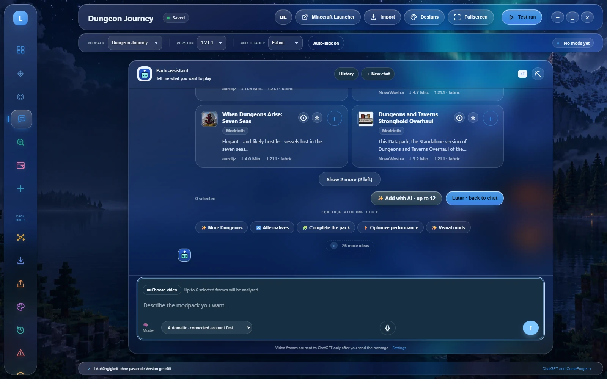
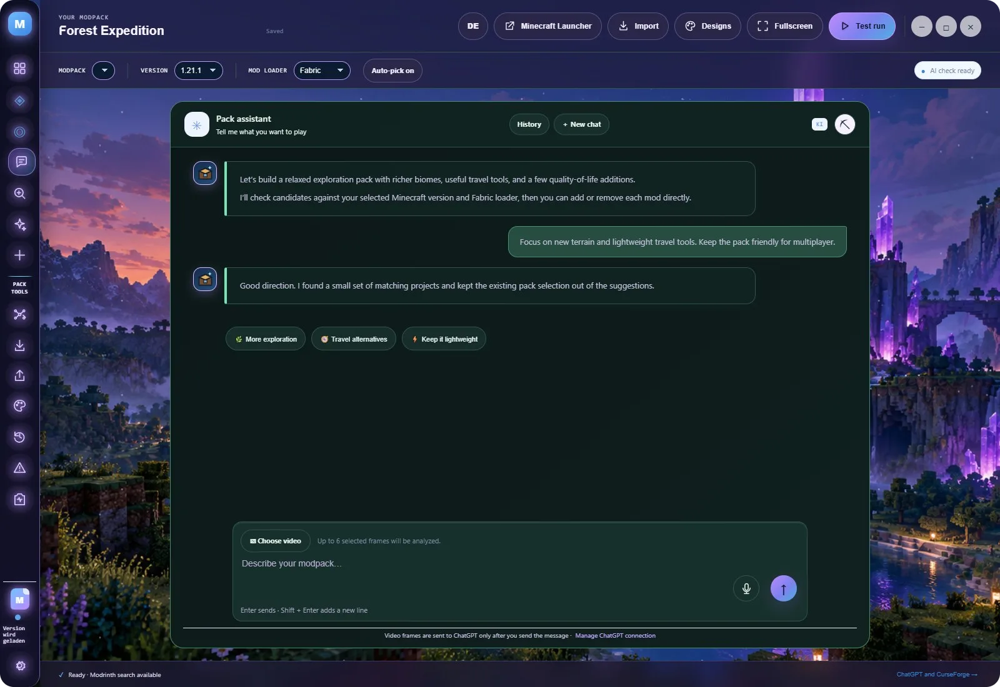
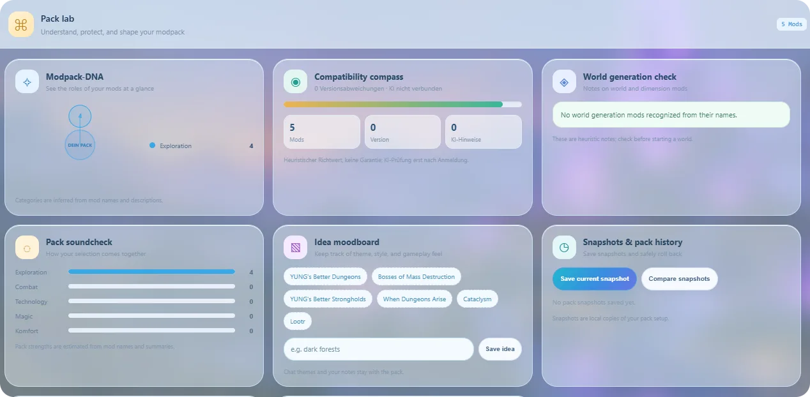

<div align="center">
  

  <h1>Modspire</h1>
  <p><strong>Your Minecraft Java modpack studio.</strong><br>Search Modrinth, shape an idea, compare pack variants and export an installable <code>.mrpack</code>. Local-first. AI optional.</p>
  <p>
    <a href="https://github.com/LvisXVI/modspire/releases/latest"></a>
    
    
    <a href="docs/wiki/README.md"></a>
  </p>
  <p>
    <a href="https://lvisxvi.github.io/modspire/">🌐 Website</a> ·
    <a href="https://lvisxvi.github.io/modspire/demo/#demo">🧪 Browser demo</a> ·
    <a href="https://github.com/LvisXVI/modspire/releases/latest">⬇️ Download for Windows</a> ·
    <a href="https://github.com/LvisXVI/modspire/discussions">💬 Feedback</a>
  </p>
</div>

---

> **New in [0.3.2](CHANGELOG.md):** **UI 5 · Liquid Glass** – frosted panels over your Minecraft world with soft transitions – plus fixes across all four existing layouts: readable headings on every theme, calmer chat follow-ups and a fully English interface.
>
> **0.3.0 – 0.3.1:** the real **Mod Studio** built in, snapshot comparisons, cross-pack bookmarks, selective updates with automatic backups, dependency explanations and installable `.mrpack` export.

## ✨ Explore the studio

<table>
  <tr>
    <td width="50%"><br><strong>🤖 Pack Assistant</strong><br>Turn an idea into a plan, then continue with one-click directions.</td>
    <td width="50%"><br><strong>🔎 Modrinth catalog</strong><br>Filter by topic, version, loader, category, environment and popularity.</td>
  </tr>
  <tr>
    <td width="50%"><br><strong>🧪 Pack Lab</strong><br>Roles, balance, snapshots, comparisons and a log-citing crash analyzer.</td>
    <td width="50%"><br><strong>🎨 Five layouts</strong><br>Classic, Modern, UI 3, UI 4 and Liquid Glass – with nine themes and Minecraft backgrounds.</td>
  </tr>
</table>

## 🧰 What you can do

| | |
|---|---|
| 🗂️ **Projects** | Multiple packs with their own Minecraft version, loader, selection and chat history. |
| 💬 **AI planning (optional)** | Review Modrinth suggestions before anything changes. ChatGPT account, OpenAI/Anthropic API, Ollama/Bionic, OmniRoute or a local OpenCode server. |
| 🔍 **Search without AI** | Modrinth works with no account; CurseForge with your own approved key. |
| 🧩 **Dependencies** | Required dependencies and client/server environments explained, including which parent pulled a library in. |
| ⇄ **Snapshots** | Name, compare (added / removed / changed) and restore pack variants. |
| ⬆ **Safe updates** | Preview compatible Modrinth updates, pick versions, automatic snapshot first. |
| 📦 **Import & export** | Share codes, public pack links and `.mrpack` in; exact-version `.mrpack` with hashes and loader version out. |
| ⭐ **Bookmarks & favourites** | Cross-pack bookmarks with notes; weekly Modrinth favourites from local daily snapshots. |
| 🛠️ **Mod Studio** | The real Studio opens in your browser on `127.0.0.1`: pixel textures, Blockbench, Java source and supported JAR builds. |
| ↶ **Undo / redo** | Selection history with Ctrl+Z / Ctrl+Shift+Z (or Ctrl+Y). |
| 🌐 **Local web view** | Same workspace in your browser while the desktop app runs; keys never reach the browser. |

> **Limits, honestly:** Modspire organises packs and reviews metadata. It does not install a loader or prove that a pack starts in a world. Shader export needs a compatible official Iris runtime on Fabric or NeoForge; CurseForge archive export is not supported yet. See the [community test disclaimer](PUBLIC-TEST-DISCLAIMER.md).

## 🚀 Get started

Download the portable build from [Releases](https://github.com/LvisXVI/modspire/releases/latest) and double-click it. The first launch asks for a local display name (not an account).

From source on Windows 10/11 with Node.js 22+ and pnpm:

```powershell
pnpm install
pnpm start
pnpm test
pnpm dist        # release/Modspire-<version>-Portable.exe
```

Building needs the verified Mod Studio runtimes: `pnpm studio:sync -- <path-to-minecraft-mod-studio>` copies the Studio source and checks the JDK/Gradle archives.

## 🔒 AI and privacy

Mod search works without AI. Credentials are stored by the desktop service and encrypted with Windows DPAPI-backed Electron `safeStorage` where available. Chat text and media go to the provider you choose, only when you send them. OpenCode chats run in a separate directory with all tools denied. Details: [AI & privacy](docs/wiki/ai-privacy.md).

## 📚 Docs

[Getting started](docs/wiki/getting-started.md) · [Mod search](docs/wiki/mod-search.md) · [Interfaces & designs](docs/wiki/interfaces-and-designs.md) · [Mod Studio integration](docs/mod-studio-integration.md) · [Troubleshooting](docs/wiki/troubleshooting-development.md) · [Patch log](docs/wiki/patch-log.md) · [Changelog](CHANGELOG.md)

Found something confusing? [Report a bug](https://github.com/LvisXVI/modspire/issues/new?template=bug_report.yml) with your version, layout/theme, what you expected and what happened. Want to help? See [CONTRIBUTING.md](CONTRIBUTING.md).

## 🌐 The project family

**Modspire** plans modpacks, [Mod Studio](https://github.com/LvisXVI/minecraft-mod-studio) builds mods, [Minecraft Host](https://github.com/LvisXVI/minecraft-host) runs the server for your friends. Every website has a switcher at the top to jump between them.

## ⚖️ Licensing

Original Modspire files are MIT; see [LICENSE](LICENSE). The bundled Sign in with ChatGPT DevKit has a separate noncommercial licence at `vendor/siwc-local/DEVKIT-LICENSE`, so this combined repository is source-available under multiple licences rather than an OSI open-source release. See [third-party notices](THIRD-PARTY-NOTICES.md).

Modspire is independent and not affiliated with or endorsed by Microsoft, Mojang, Modrinth, CurseForge, OpenAI or Anthropic. Minecraft and third-party names belong to their owners.
