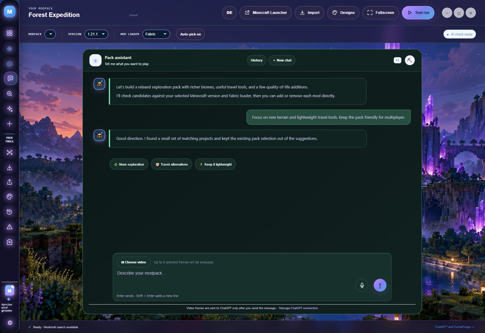
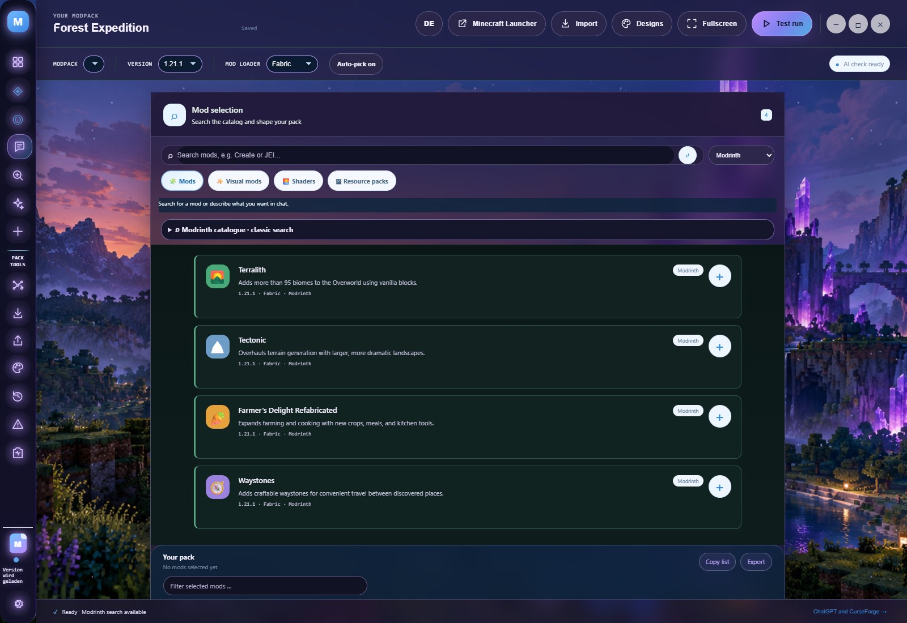
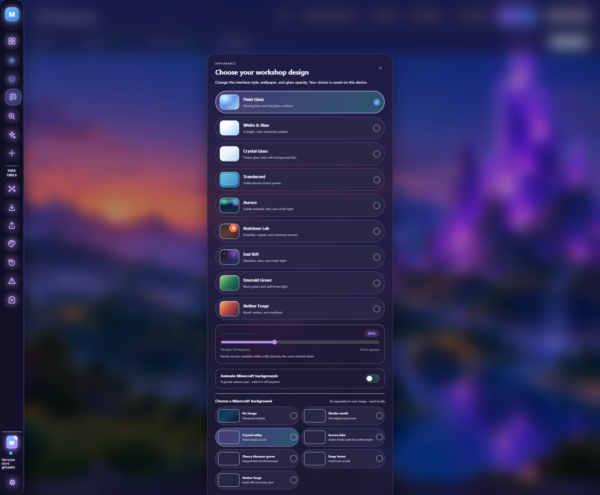

# Modpack-Werkstatt

An independent, free Windows desktop app for planning Minecraft Java modpacks. Describe the kind of pack you want, find candidates on Modrinth, optionally use CurseForge with your own API key, and review compatibility before choosing mods. The app has no subscription or paid feature tier.

This is an independent project. It is not affiliated with or endorsed by Modbot, Modrinth, CurseForge, Microsoft, Mojang, or OpenAI. It takes inspiration from prompt-led modpack workflows without using Modbot branding or assets.

## Features

- Local-only username and separate modpack projects, with each pack's own version, selection, and chat history
- Switchable German and English interface; AI replies and compatibility reports follow the selected language
- Modpack selector in the top setup strip alongside Minecraft version and modloader
- Context-aware chat suggestions under every reply, multi-select AI choice chips, multi-facet Modrinth search, and optional video-frame analysis
- Modrinth search without a key; CurseForge search falls back to Modrinth unless you configure your own CurseForge key
- Search results load in 48-item batches and continue scrolling until the selected Modrinth catalog is exhausted
- Import a Modrinth share code, public modpack link, or `.mrpack` as a new editable project with mod names, Minecraft version, and loader
- Optional automatic Minecraft version and modloader selection based on Modrinth catalog results for the requested theme
- Check several mod candidates and add them together, or add the full filtered pack foundation in one click
- Chat suggestions add to the active pack immediately from the card or plus button; minus removes a mod without a second confirmation
- Visual-mod search combines multiple Modrinth search terms with visual category facets and continues paging as you scroll
- Two-column mod cards in the regular window and fullscreen layout
- A sidebar AI Mod Creator entry for planning a new Java mod and drafting its code structure
- Four selectable interface layouts: the original workshop, the modern pack dashboard, UI Version 3, and UI Version 4
- UI Version 3 includes a clean Pro Studio style and six selectable Minecraft world scenes with matching accent colors
- Modern dashboard navigation stays visible on desktop and opens the same chat, mod search, and pack tools as the sidebar
- ChatGPT sign-in with explicit plan-sharing consent, optional OpenAI or Claude providers, local Ollama/Bionic models, and OmniRoute-compatible OpenAI endpoints
- OmniRoute automatic model routing in the chat model picker (cloud icon); the `auto` mode delegates model selection to the connected OmniRoute router
- Mod suggestions are parsed and searched by the app itself, so local and cloud models can open the same selectable Modrinth results without model-specific tool calling
- Automatic compatibility reports and a manual test-run button with suggested safe fixes
- Multiple distinct designs: White and Blue, Fluid Glass, blurred tinted Crystal Glass and Translucent, subdued animated Polarlicht, Redstone-Labor, Smaragdhain, Nether-Schmiede, and Ender-Riss. Backgrounds are selected separately; Minecraft wallpapers support a persistent motion toggle.
- Chat scrolling remains available with the mouse wheel while the scrollbar stays hidden; translucent designs use reinforced text contrast
- Design editor available from both the sidebar and the top toolbar, with hover descriptions positioned beside the icon rail
- Compact icon sidebar, hover descriptions beside the icon rail, and fullscreen mode with the F11 shortcut
- Local project export, hover explanations, and a Windows portable build

## Build and AI access

Mod search does not require an AI account. ChatGPT account sharing, direct OpenAI/Claude APIs, local Ollama/Bionic models, and an OmniRoute endpoint are optional AI routes. OmniRoute's `auto` mode chooses a model from the providers configured in that OmniRoute service; it cannot configure providers or add credits on the user's behalf. OmniRoute endpoint credentials are stored encrypted on the local Windows account. Local-model feature support varies by runtime and model; this project has not been tested against every local model and does not guarantee compatibility with every model or cloud agent. See [PUBLIC-TEST-DISCLAIMER.md](PUBLIC-TEST-DISCLAIMER.md).

## Test-project notice

This is an independent test project for evaluation and experimentation. It is not a production-ready or security-certified mod manager. Mod metadata, compatibility claims, model responses, and third-party services can be incomplete, change, or fail. Back up modpacks and configuration before testing. AI requests and uploaded media are sent to the provider selected by the user; review that provider's privacy and usage terms before sending data. Minecraft and third-party service names belong to their respective owners. See the full [test disclaimer](PUBLIC-TEST-DISCLAIMER.md) and [third-party notices](THIRD-PARTY-NOTICES.md).

## Wiki

The project wiki is maintained in [`docs/wiki/`](docs/wiki/README.md). It covers setup, AI providers, mod search, design modes, privacy, troubleshooting, and development notes.

## Screenshots


These additional captures show the AI-assisted workflow, catalog search, and appearance controls. They use illustrative sample pack content; live suggestions and catalog results depend on the connected providers.








## What is not implemented yet

The current test-run checks the pack with the connected AI. It does not yet download mod files, install a loader or create a Minecraft Launcher installation, and it does not start Minecraft through to a loaded test world. The app describes those limits in its UI rather than claiming an in-game test has passed.

## Run from source

Requirements: Windows 10 or 11, Node.js 22+, and pnpm.

```powershell
pnpm install
pnpm start
pnpm test
pnpm dist
```

The portable `.exe` is written to `release/`. `pnpm test` runs the browser, Electron, provider, performance, catalog, theme, and smoke tests in `tests/`.

On first launch, choose a local display name. It is stored in the app's Windows user-data folder and does not have to be unique. ChatGPT login and plan sharing are separate; a username does not create an account or remove provider usage limits. ChatGPT sharing availability and limits are controlled by OpenAI. CurseForge requires the user's own approved API key.

## Lokale Web-Version

Der Button **Web-Version** in der Sidebar öffnet dieselbe Werkstatt im Standardbrowser unter einer lokalen `127.0.0.1`-Adresse. Die Desktop-App muss währenddessen geöffnet bleiben; sie stellt Katalogsuche, Kontoverbindungen, lokale Modelle, Spracheingabe, Dateiimporte und Exporte bereit. Es wird keine Website veröffentlicht.

Alle vier UI-Ansichten und die gespeicherten Design-Einstellungen werden übernommen. Pack-Projekte nutzen denselben lokalen Speicher. Während der Browser bearbeitet, pausiert die Desktop-Bearbeitung. **Zur Desktop-App** speichert die letzten Änderungen und übernimmt die Browser-Einstellungen zurück. Ein zusätzlicher Browser-Tab bleibt gesperrt, damit er keine ältere Pack-Auswahl zurückschreiben kann.

Vor einem Wechsel müssen laufende Antworten, Mod-Suchen und Abhängigkeitsprüfungen fertig sein. Die Eingaben sind nur während des kurzen Speichervorgangs gesperrt. Wenn du den Browser schließt, kannst du nach einer kurzen Verbindungsfrist über den Rückkehrbutton im Desktop-Fenster weiterarbeiten.

Die Website selbst läuft lokal. Katalogabfragen und ausdrücklich gesendete KI-Anfragen verwenden weiterhin die eingerichteten Anbieter. Zugangsdaten bleiben im Desktop-Dienst; die Browseransicht erhält keine gespeicherten API-Schlüssel.

## Privacy

Project content and the display name are stored locally. Chat messages and attached video frames are sent to the AI provider only after you submit them. Credentials are encrypted with Windows DPAPI-backed Electron `safeStorage` where available. Mod catalog queries are sent to Modrinth, or to CurseForge when its key is configured.

## Licensing

Original Modpack-Werkstatt files are licensed under MIT; see [LICENSE](LICENSE). The bundled Sign in with ChatGPT DevKit has a separate noncommercial licence at `vendor/siwc-local/DEVKIT-LICENSE`; nonprofit status alone does not make a use noncommercial under that licence. Client integrations written independently are distinct from the DevKit bundle, but the DevKit's own terms still apply to its code. This combined repository is therefore source-available under multiple licences, not an OSI-compliant open-source release. See [THIRD-PARTY-NOTICES.md](THIRD-PARTY-NOTICES.md).
